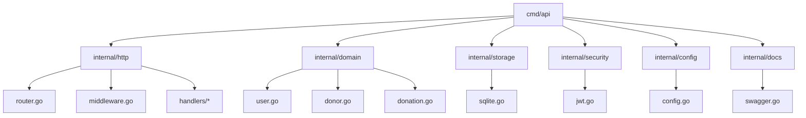
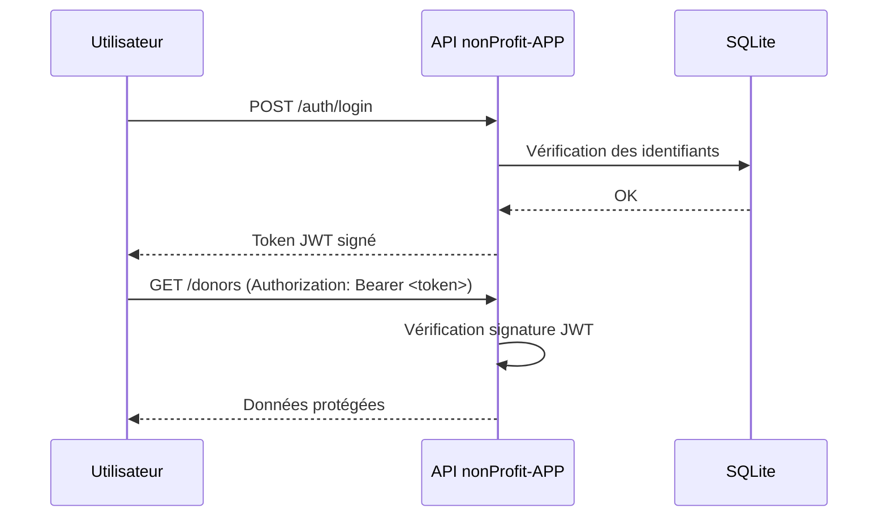

###### README.md >> markdown 
###### - version Black‑Futuriste, Full Badges, Mermaid, Graphismes, Tech‑Diagrams, Modern UI, Next‑Gen Styling.
###### - achievements GitHub (Maintainer, Contributor, Community, DevOps, Security, Releases, Documentation

# 🟦 nonProfit‑APP

<p align="center">
  
- ***API REST moderne***

- ***sécurisée en Go 1.23***

</p>

---
<p align="right">
  
  
  
  
  
  
</p>

</br>

<p align="left">
  
  
  
  
</p>

---
### ✨ Présentation
- Une *API REST moderne*, scalable, sécurisée, *écrite en Go 1.23*, pensée pour gérer :
```text
- les utilisateurs (authentification JWT)
- les donateurs
- les dons
- les campagnes (extension possible)
```

>>*Architecture propre, modulaire, production‑ready, avec CI/CD, logs structurés, configuration dynamique, migrations automatiques, et documentation Swagger*.

---

### ⚙️ Architecture Technique
- — Vue d’ensemble
````mermaid
flowchart TD
    A[Client HTTP] --> B[API Gateway - Chi Router]
    B --> C[Middleware JWT]
    C --> D[Handlers REST]
    D --> E[Services Métier]
    E --> F[SQLite + GORM]
    E --> G[Logger Zap]
    E --> H[Config Viper]
````

---

### 🧬 Structure du projet



---

### 🚀 Fonctionnalités principales
#### 🔐 Authentification JWT
```markdown
- POST /auth/register — création d’un utilisateur  
- POST /auth/login — génération d’un token JWT  
- Middleware de protection des routes  
- Extraction automatique du user_id depuis le token  
```

#### 👥 Donateurs
- GET /donors — liste des donateurs  
- POST /donors — création d’un donateur  

#### 💸 Dons
- GET /donations — liste des dons  
- POST /donations — création d’un don  

#### 🗄️ Base de données SQLite
- Auto‑migrations via GORM  
- Modèles : User, Donor, Donation

#### ⚙️ Configuration (Viper)
- Port serveur  
- Chemin SQLite  
- Secret JWT  
- Mode debug  

#### 📦 CI/CD GitHub Actions
- Build  
- Tests  
- Lint  
- Go 1.23  

#### 📘 Swagger
>>activable

---

#### 🛰️ Diagramme Sécurité
- — JWT Flow



---

### 🧪 Endpoints REST

#### 👥 Donors

| Méthode | Endpoint     | Description |
|---------|--------------|-------------|
| GET     | /donors      | Liste des donateurs |
| POST    | /donors      | Créer un donateur |

#### 💸 Donations

| Méthode | Endpoint     | Description |
|---------|--------------|-------------|
| GET     | /donations   | Liste des dons |
| POST    | /donations   | Créer un don |

---

#### 🔧 Configuration
- config.yaml

```yaml
server:
  port: 8080

database:
  path: "nonProfit-APP.db"

security:
  jwtsecret: "CHANGEMETOALONGRANDOM_SECRET"

app:
  debug: true
```

---

### 🐳 Docker

```bash
docker build -t nonprofit-app .
docker run -p 8080:8080 nonprofit-app
```

---

### 🛠️ Installation & Lancement

```bash
git clone https://github.com/teremuhamblin/nonProfit-APP
cd nonProfit-APP
go mod tidy
go run ./cmd/api
```

---

### 🧱 Technologies utilisées

```markdown
- Go 1.23
- Chi Router
- GORM + SQLite
- Viper
- Zap Logger
- JWT (golang-jwt v5)
- GitHub Actions
- Docker
```

---

### 🧭 Roadmap
###### 📄 Voir : nonProfit-APP/docs/ROADMAP.md

---

### 🏁 Conclusion
>>Ce projet est une base solide, moderne, sécurisée, et scalable pour construire une API Go professionnelle.
   - Il est conçu pour être simple à comprendre, facile à étendre, et prêt pour la production.

---
