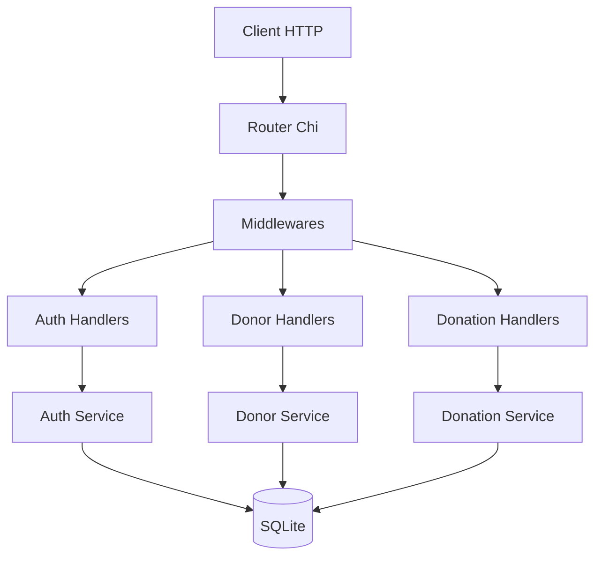
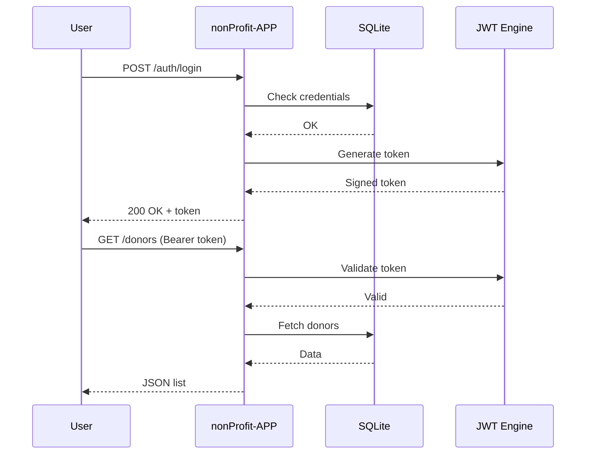

###### docs/API.md >> markdown
```text
ultra‑professionnel, moderne, structuré, avec schémas, mermaid, tableaux, exemples JSON, et sections prêtes pour la production.
```

# 📘 nonProfit‑APP
### API Documentation

<p align="center">
  
  
  
  
</p>

---

### 🧭 1. Introduction

Cette documentation décrit l’*ensemble des endpoints REST de l’API nonProfit‑APP*, une API moderne écrite en **Go 1.23**, utilisant :
```markdown
- Chi Router  
- JWT Authentication  
- SQLite + GORM  
- Viper (config)  
- Zap (logging)  
```

---

### 🧬 2. Architecture API



---

### 🔐 3. Authentification JWT
#### 3.1 Register — Créer un utilisateur
   - POST /auth/register

>>Request
```json
{
  "email": "user@example.com",
  "password": "secret"
}
```

>>Response
```json
{
  "success": true,
  "message": "User created successfully"
}
```

---

#### 3.2 Login — Obtenir un token JWT
   - POST /auth/login

>>Request
```json
{
  "email": "user@example.com",
  "password": "secret"
}
```

>>Response
```json
{
  "success": true,
  "data": {
    "token": "eyJhbGciOiJIUzI1NiIsInR..."
  }
}
```

---

#### 3.3 Utilisation du token

```markdown
Authorization: Bearer <token>
```

---

### 🛡️ 4. Flux JWT — Diagramme avancé



---

### 👥 5. Donors API

#### 5.1 GET /donors — Liste des donateurs

>>Response
```json
{
  "success": true,
  "data": [
    {
      "id": 1,
      "name": "John Doe",
      "email": "john@example.com",
      "created_at": "2024-01-01T12:00:00Z"
    }
  ]
}
```

---

#### 5.2 POST /donors — Créer un donateur

>>Request
```json
{
  "name": "Alice",
  "email": "alice@example.com"
}
```

>>Response
```json
{
  "success": true,
  "data": {
    "id": 2,
    "name": "Alice",
    "email": "alice@example.com"
  }
}
```

---

### 💸 6. Donations API

#### 6.1 GET /donations — Liste des dons

>>Response
```json
{
  "success": true,
  "data": [
    {
      "id": 1,
      "donor_id": 2,
      "amount": 50,
      "created_at": "2024-01-02T14:00:00Z"
    }
  ]
}
```

---

#### 6.2 POST /donations — Créer un don

>>Request
```json
{
  "donor_id": 2,
  "amount": 50
}
```

>>Response
```json
{
  "success": true,
  "data": {
    "id": 3,
    "donor_id": 2,
    "amount": 50
  }
}
```

---

### 🧱 7. Tableaux récapitulatifs

#### 7.1 Endpoints

| Domaine    | Méthode | Endpoint       | Auth | Description |
|-----------|---------|----------------|------|-------------|
| Auth      | POST    | /auth/register | ❌   | Créer un utilisateur |
| Auth      | POST    | /auth/login    | ❌   | Obtenir un token JWT |
| Donors    | GET     | /donors        | ✅   | Liste des donateurs |
| Donors    | POST    | /donors        | ✅   | Créer un donateur |
| Donations | GET     | /donations     | ✅   | Liste des dons |
| Donations | POST    | /donations     | ✅   | Créer un don |

---

### 🗄️ 8. Modèles de données

>>User
```json
{
  "id": 1,
  "email": "user@example.com",
  "password_hash": "...",
  "created_at": "2024-01-01T12:00:00Z"
}
```

>>Donor
```json
{
  "id": 1,
  "name": "John Doe",
  "email": "john@example.com",
  "created_at": "2024-01-01T12:00:00Z"
}
```

>>Donation
```json
{
  "id": 1,
  "donor_id": 1,
  "amount": 50,
  "created_at": "2024-01-02T14:00:00Z"
}
```

---

### ⚙️ 9. Erreurs & Codes HTTP

| Code | Signification | Exemple |
|------|---------------|---------|
| 200  | OK | Requête réussie |
| 201  | Created | Ressource créée |
| 400  | Bad Request | Données invalides |
| 401  | Unauthorized | Token manquant ou invalide |
| 404  | Not Found | Ressource inexistante |
| 500  | Server Error | Erreur interne |

---

##$ 🧪 10. Tests API (exemples)

>>Auth
```bash
curl -X POST http://localhost:8080/auth/login \
  -H "Content-Type: application/json" \
  -d '{"email":"user@example.com","password":"secret"}'
```

>>Donors
```bash
curl -X GET http://localhost:8080/donors \
  -H "Authorization: Bearer <token>"
```

---

### 🏁 Conclusion

- Cette documentation couvre l’ensemble des endpoints REST de l’API nonProfit‑APP, avec :
```markdown
- schémas techniques  
- mermaid avancés  
- tableaux professionnels  
- exemples JSON  
- flux JWT
```

---
