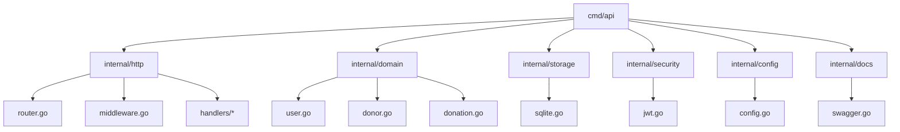
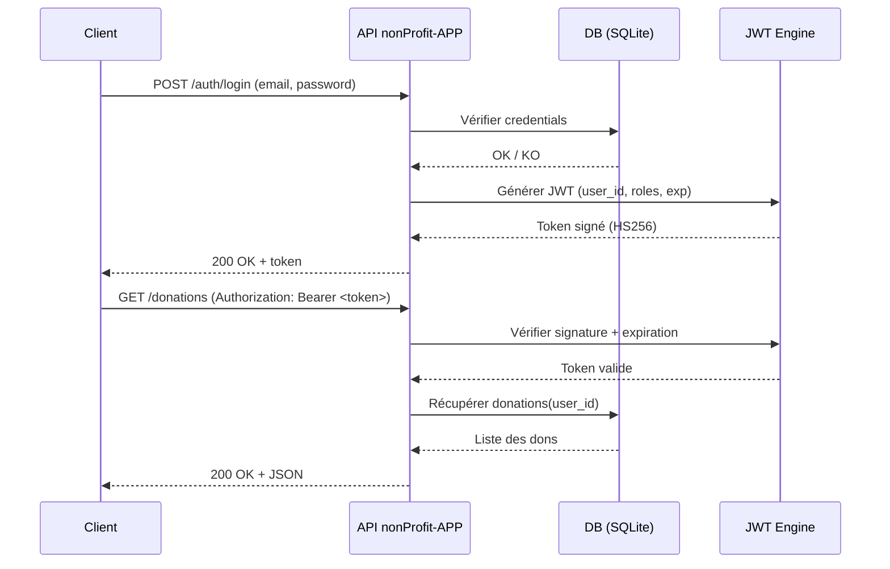

###### ARCHITECTURE.md >> markdown 
# nonProfit-APP
###### docs/ARCHITECTURE.md

### 🧬 Architecture technique
#### 🏷️ Vue d’ensemble
- nonProfit-APP est une API REST sécurisée en Go 1.23, basée sur Chi, avec :
```text
- Authentification JWT
- SQLite via GORM
- Configuration dynamique via Viper
- Logging structuré via Zap
- CI/CD GitHub Actions
- Conteneurisation Docker
```

---

### 🧱 Architecture globale

```mermaid
flowchart TD
    Client[Client HTTP / Frontend] --> API[nonProfit-APP API (Go + Chi)]
    API --> MW[Middlewares (JWT, Logging, Recovery)]
    API --> H[Handlers REST]
    H --> S[Services métier]
    S --> DB[(SQLite via GORM)]
    S --> CFG[Config (Viper)]
    S --> LOG[Logger (Zap)]
```

---

### 🧩 Organisation du code



---

### 🛡️ Sécurité — Flux JWT



---

### ⚙️ Pipeline CI/CD

```mermaid
flowchart LR
    Dev[Developer Push] --> GH[GitHub Repo]
    GH --> CI[Workflow ci.yml]
    CI --> B[go build ./...]
    CI --> T[go test ./...]
    CI --> L[golangci-lint run]
    CI --> SEC[go vet / security checks]
    CI --> REL[release.yml (tag + changelog)]
    REL --> IMG[Docker build & push]
```

---

### 🧱 Dataflow Donors / Donations

```mermaid
flowchart TD
    U[User (JWT)] --> API[nonProfit-APP API]
    API --> DNR[Donor Service]
    API --> DON[Donation Service]

    DNR --> DB[(SQLite)]
    DON --> DB

    DB --> RPT[Reporting / Stats (future)]
```

---

### 📊 Stack technique

| Composant       | Technologie      | Rôle                          |
|-----------------|------------------|-------------------------------|
| Langage         | Go 1.23          | Backend API                   |
| Router          | Chi              | Routing HTTP                  |
| ORM             | GORM             | Accès DB SQLite               |
| Base de données | SQLite           | Stockage persistant           |
| Config          | Viper            | Configuration dynamique       |
| Logging         | Zap              | Logs structurés               |
| Auth            | golang-jwt v5    | JWT HS256                     |
| CI/CD           | GitHub Actions   | Build, tests, lint, release   |
| Conteneur       | Docker           | Déploiement containerisé      |

---

### 📌 Endpoints principaux

| Domaine    | Méthode | Endpoint       | Auth JWT | Description                    |
|-----------|---------|----------------|----------|--------------------------------|
| Auth      | POST    | /auth/register | ❌       | Créer un utilisateur           |
| Auth      | POST    | /auth/login    | ❌       | Obtenir un token JWT           |
| Donors    | GET     | /donors        | ✅       | Liste des donateurs            |
| Donors    | POST    | /donors        | ✅       | Créer un donateur              |
| Donations | GET     | /donations     | ✅       | Liste des dons                 |
| Donations | POST    | /donations     | ✅       | Créer un don                   |

---

### Badges pour *README.md*

```md
<p align="center">
  
  
  
  
  
  
</p>

<p align="center">
  
  
  
  
</p>
```

---
