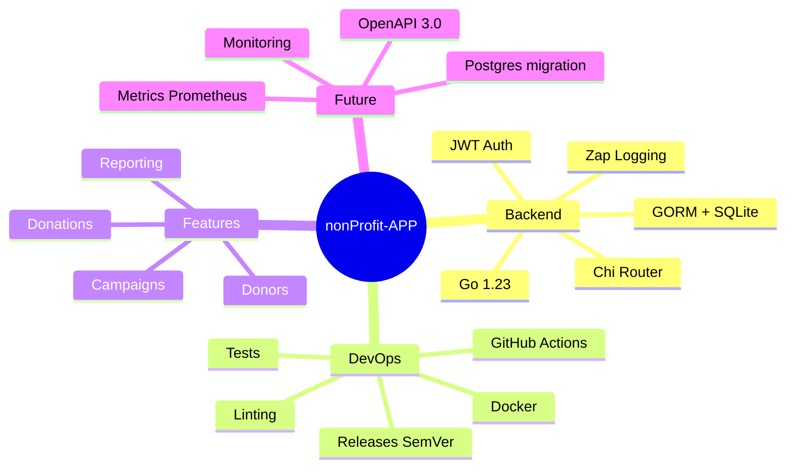
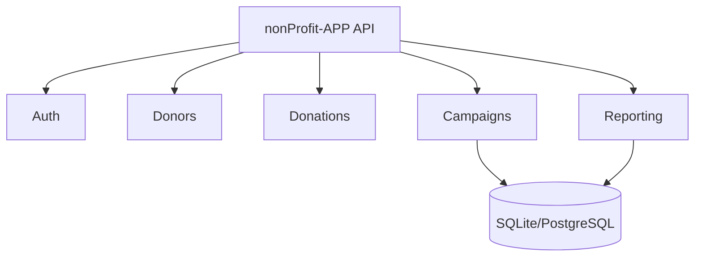
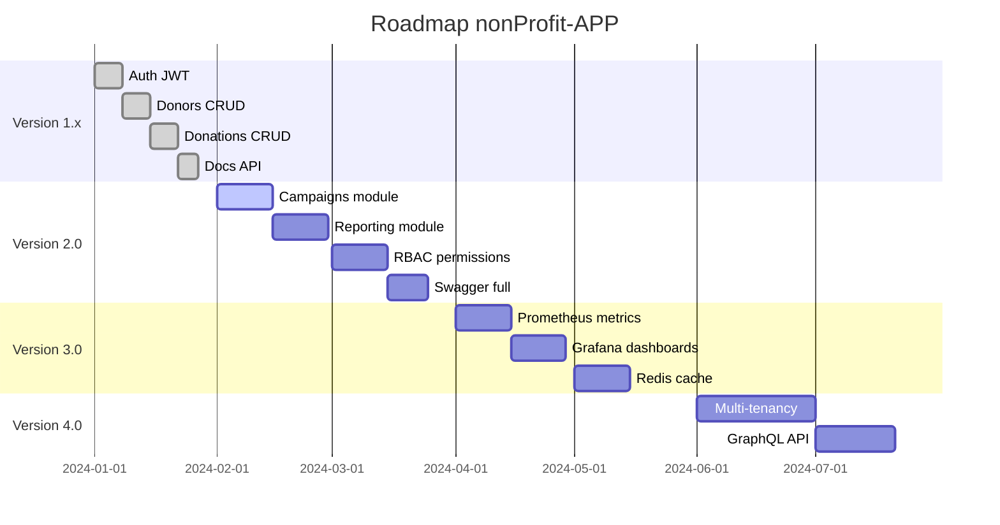

###### 🅰️ docs/ROADMAP.md
# 🧭 nonProfit-APP
- nonProfit-APP est une API moderne en Go 1.23, conçue pour être scalable, sécurisée et extensible.  
   - Cette roadmap présente les objectifs techniques, les évolutions prévues et les futures fonctionnalités.

---

### 🗺️ Vision globale



---

### 📌 Objectifs par version
#### ✅ v1.x
- Version actuelle

| Domaine | Objectif | Statut |
|--------|----------|--------|
| Auth | JWT complet | ✔️ |
| Donors | CRUD minimal | ✔️ |
| Donations | CRUD minimal | ✔️ |
| DB | SQLite + migrations | ✔️ |
| Logs | Zap | ✔️ |
| Config | Viper | ✔️ |
| CI/CD | Build + tests | 🔄 En cours |
| Docs | README + API | ✔️ |

---

#### 🚀 v2.0
>> Version majeure
```text
- 🎯 Objectifs
   - Ajout du module Campaigns
   - Ajout du module Reporting
   - Ajout d’un système de permissions (RBAC)
   - Migration optionnelle vers PostgreSQL
   - Ajout de Swagger complet
   - Ajout de tests unitaires + intégration
   - Ajout d’un dashboard admin (future extension)
```

>>📐 Diagramme des modules v2.0



---

#### 🧬 v3.0
>>Scalabilité & Observabilité
```text
- 🎯 Objectifs
   - Export métriques Prometheus
   - Intégration Grafana
   - Ajout d’un système de webhooks
   - Ajout d’un cache Redis
   - Ajout d’un rate limiter
   - Ajout d’un système d’alerting
```

---

#### 🛰️ v4.0
>>Enterprise Edition
```text
- 🎯 Objectifs
   - Multi-tenancy
   - Multi‑DB (MySQL, PostgreSQL, SQLite)
   - Système de plugins
   - API GraphQL
   - Intégration Keycloak / OAuth2
```

---

### 🧱 Roadmap détaillée (Mermaid Gantt)



---

### 🏁 Conclusion

Cette roadmap guide l’évolution du projet vers une API robuste, scalable, sécurisée et adaptée aux besoins modernes.

---
